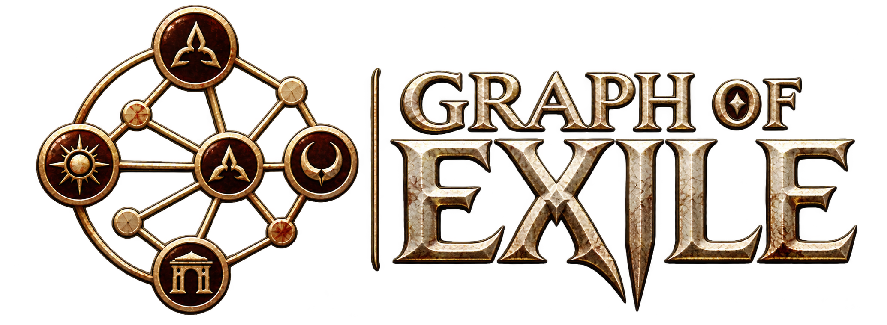
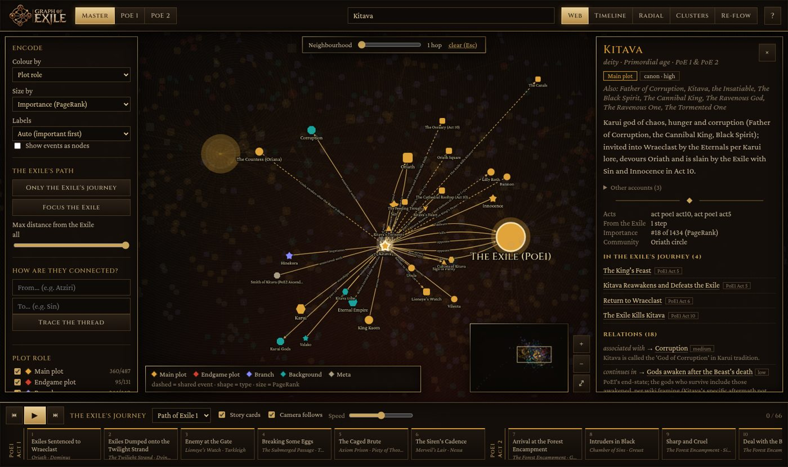
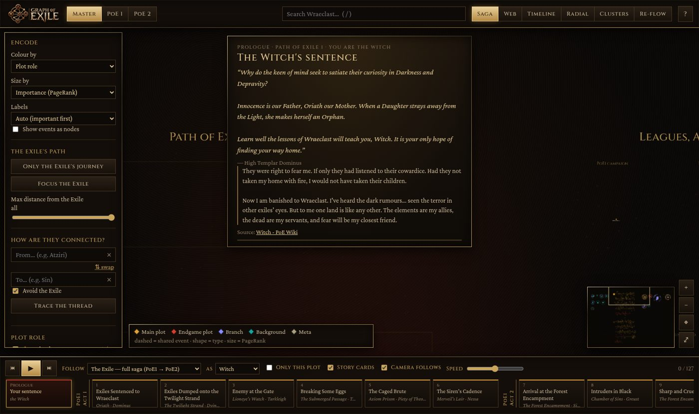
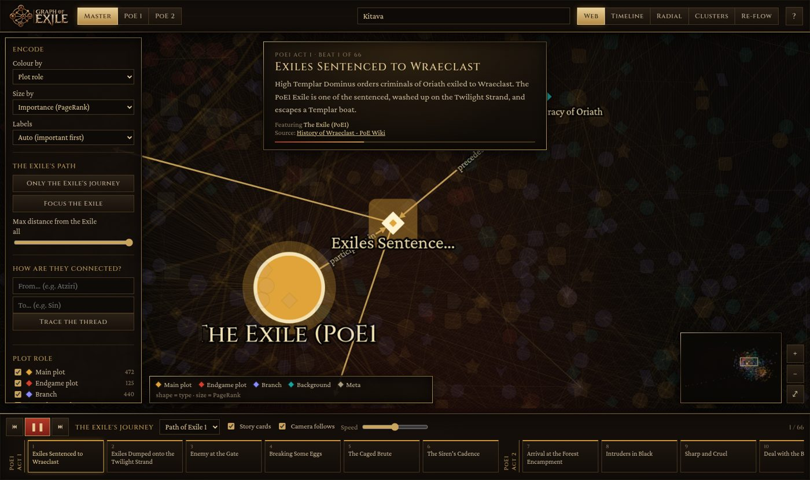
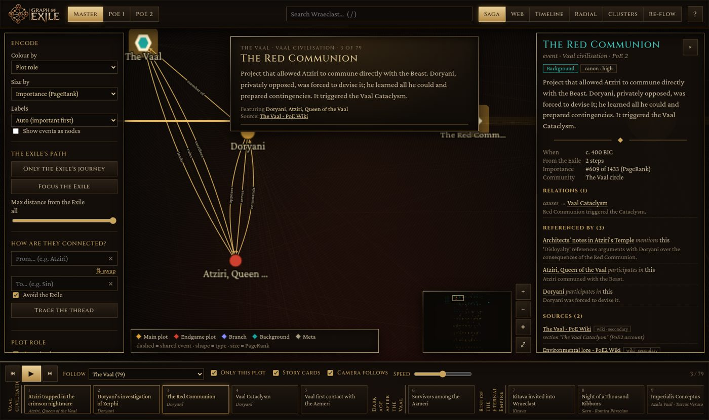
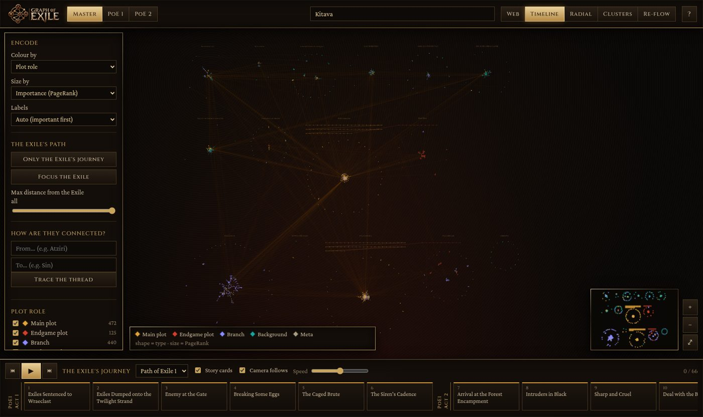

<p align="center">
  
</p>

<p align="center">
  <b>A sourced knowledge graph of Path of Exile lore, centred on the Exile.</b><br>
  From the Precursors and the Vaal to the Eternal Empire, both campaigns, the Atlas, every league storyline and the Twilight Order's Edicts.
</p>

<p align="center">
  <a href="dataset/"><b>📦 Dataset</b></a> ·
  <a href="https://tekayanidham.github.io/graph_of_exile/"><b>🗺️ Live explorer</b></a> ·
  <a href="dataset/schema/SCHEMA.md">Schema</a> ·
  <a href="dataset/STATS.md">Stats</a> ·
  <a href="https://github.com/TekayaNidham/graph_of_exile/releases">Downloads</a>
</p>

---

## 📦 The dataset

**[`dataset/`](dataset/)** is the heart of this repository: an open graph dataset for the PoE community to explore, analyse, visualise and build on.

| Variant | Nodes | Edges | Sources | |
|---|---:|---:|---:|---|
| [**Master**](dataset/master/) | 1,433 | 4,268 | 665 | Everything, incl. PoE1 → PoE2 continuity |
| [**PoE1 plot**](dataset/poe1/) | 1,035 | 3,031 | 549 | Only what appears in Path of Exile 1 (PoE2 masked) |
| [**PoE2 plot**](dataset/poe2/) | 604 | 1,657 | 319 | Only what appears in Path of Exile 2 (PoE1 masked) |

* **Formats:** JSON, CSV and GraphML (Gephi, networkx, Cytoscape, Neo4j …), plus a JSON Schema.
* **Sources:** every node and edge cites them, with a locator (wiki section, quoted dialogue or video timestamp) and a reliability grade.
* **One continuous world:** PoE2 is treated as the continuation of PoE1. Shared lore (Kingsmarch, Breach, Ritual, Abyss, the Trialmaster…) carries both games' labels. *Master* shows the whole continuous saga; the *PoE1* and *PoE2* views are strict and mask the other game.
* **Labels:**
  * `plot_role` is one of **main plot**, **endgame plot**, **branch** (70 league/side tags such as `breach`, `ritual`, `kingsmarch`, `delve`, `twilight_order`), **background** or **meta**
  * `era` follows one timeline, from the *primordial* age to the *PoE2 endgame*
  * `games` and `canon_status` / `confidence` complete the set
* **The Exile's journey:** a `next_beat` spine runs through 66 PoE1 beats (shipwreck → Kitava → Atlas → the Originator) and 61 PoE2 beats (Ogham → Act 4 → Interludes → Arbiter of Divinity).
* **Provenance:** 15 domain research fragments, 7 gap-fill, 6 journey-enrichment and 4 faction-membership fragments were each independently verified, then audited twice by a second model. All corrections are reproducible from [`dataset/curation/`](dataset/curation/).

```python
import json
g = json.load(open("dataset/master/graph.json"))
kitava = next(n for n in g["nodes"] if n["id"] == "deity_kitava")
print(kitava["summary"], [s["source_id"] for s in kitava["sources"]])
```

➡️ **Read the [dataset card](dataset/README.md)** for the full data model, quickstarts (Python, networkx, pandas, JS, Gephi), methodology, limitations and licence.

> ⚠️ **Disclaimer.** Path of Exile 2 is in Early Access. 17 nodes tagged `datamined_pre_1.0` (unreleased Acts 5–6) may change, and the dataset will be updated after **PoE2 1.0 (11 Dec 2026)**. The lore was compiled with AI assistance and cross-verified, but mistakes can remain. Please [open an issue](https://github.com/TekayaNidham/graph_of_exile/issues) with the node `id` and a source.

## 🗺️ The explorer

**<https://tekayanidham.github.io/graph_of_exile/>** is an interactive, PoE-themed visual-analytics explorer for the dataset.

<p align="center"></p>

* **The saga in order:** the default *Saga* layout reads like a triptych: *Before the Exile* (deep history) → the PoE1 journey → *twenty years later* → the PoE2 journey, with leagues, Atlas and side lore alongside. Story beats sit on a serpentine journey line, with the people and places of each beat beside it.
* **Follow any plot:** follow the Exile (PoE1, PoE2 or the full saga), or **any faction, god or character** (the Vaal, the Karui, the Eternal Empire, the Twilight Order, Kitava…). Their events become the playable journey, in chronological order, and *Only this plot* hides everything else.
* **Choose your Exile:** pick your class to read **your sentence** (High Templar Dominus's words to you in PoE1, Count Geonor's gallows in PoE2) and your exile's own words, quoted from the class pages, as a playable prologue.
* **Story mode:** ▶ plays the journey beat by beat. It lights up who is involved and where, a gold trail follows the Exile from place to place, and story cards (optional) carry the sources.
* **People and places first:** characters, gods, factions and locations are the nodes; events become dashed *shared event* links between them (toggle *Show events as nodes* for the raw event view).
* **Six layouts:** Saga; Web (force-directed); Timeline (eras left → right, swimlanes for gods, factions, characters, places, events and lore); Exile-centred radial rings; Louvain community clusters; and a live re-flow of what is visible.
* **Encodings:** colour by plot role, era, type, community, confidence or game; size by PageRank, betweenness or degree.
* **Focus + context:** k-hop neighbourhood highlighting, hover previews, box selection, a minimap, linked facet counts, and a **⌖ recenter** button (`C`) that takes you back to the current beat, selection or trace when you get lost.
* **"How are they connected?":** shortest-path tracing between any two entities with type-ahead pickers, swap, *Avoid the Exile* (the Exile touches everything; avoiding it reveals the lore's own threads, e.g. *Atziri → the Beast → Sin*) and *Stop tracing*.
* **Filters:** plot role, era, type, branch/league, relation, confidence, datamined content, and distance from the Exile.
* **Shareable:** deep-link URLs keep the variant, layout, encoding, followed plot, chosen exile and selection. Keyboard shortcuts (`/`, `Space`, `←` `→`, `1`–`6`, `C`, `F`, `?`) and reduced-motion support are built in.

<p align="center"> </p>
<p align="center"> </p>

Run it locally: `python3 -m http.server -d explorer 8000` → <http://localhost:8000>.

## 🗂️ Repository layout

```
dataset/            ← the dataset (start here)
  master/ poe1/ poe2/   graph.json · nodes/edges/sources .json · .csv · graph.graphml
  schema/               SCHEMA.md · graph.schema.json
  extras/               exile_profiles.json (each class's sentence and own words, quoted from the class pages)
  fragments/            per-domain research fragments (provenance)
  curation/             id_aliases.json · patches.json (audited corrections with reasons)
  STATS.md · stats.json · README.md (dataset card) · LICENSE (CC BY-NC-SA 3.0)
explorer/           ← static web explorer (GitHub Pages)
scripts/            ← pipeline: wiki_dump · yt_* · validate_fragment · merge · stats · build_site
verification/       ← per-domain fact-check reports, two Codex audits, merge report
docs/               ← build plan, canonical id list, images
```

## 🔁 Rebuild

```bash
python3 -m venv .venv && .venv/bin/pip install networkx numpy scipy jsonschema
.venv/bin/python scripts/merge.py        # fragments + curation → dataset/{master,poe1,poe2}
.venv/bin/python scripts/stats.py        # → dataset/STATS.md, stats.json
.venv/bin/python scripts/build_exiles.py # → dataset/extras/exile_profiles.json (needs the raw class pages)
.venv/bin/python scripts/build_site.py   # → explorer/data (layouts, PageRank, communities)
for v in master poe1 poe2; do python3 scripts/validate_fragment.py dataset/$v/graph.json --strict-refs; done
```
The raw corpus is not redistributed. Regenerate it with `scripts/wiki_dump.py` (MediaWiki API) and `scripts/yt_collect.sh` / `scripts/yt_slow.py`.

## 📜 Licence & credits

* **Dataset:** [CC BY-NC-SA 3.0](dataset/LICENSE), as it adapts text from the community wikis [poewiki.net](https://www.poewiki.net) and [poe2wiki.net](https://www.poe2wiki.net). Thanks to their editors, and to the lore creators whose videos are cited in `sources.json`.
* **Code:** [MIT](LICENSE). **Logo:** not covered by either licence.
* *Path of Exile* is a trademark of Grinding Gear Games. This is a fan project, not affiliated with or endorsed by Grinding Gear Games.
* Cite via [`CITATION.cff`](CITATION.cff). Created by **Nidham Tekaya**.
